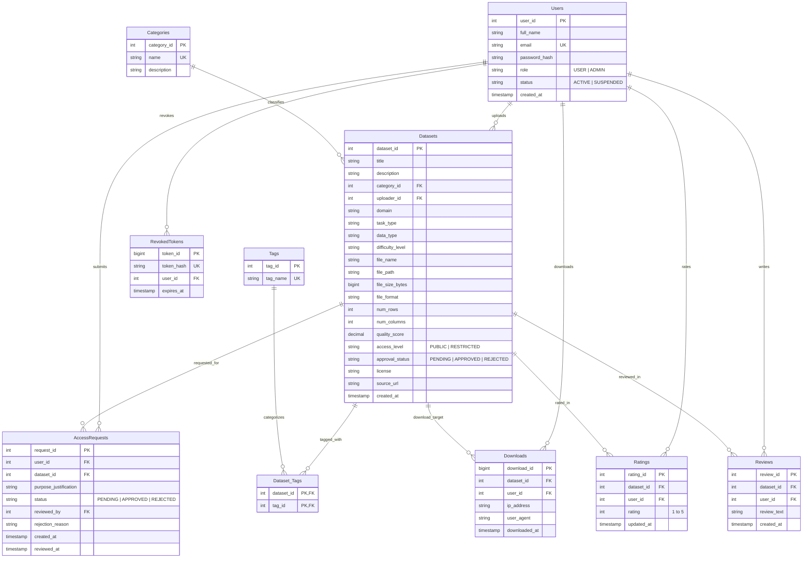
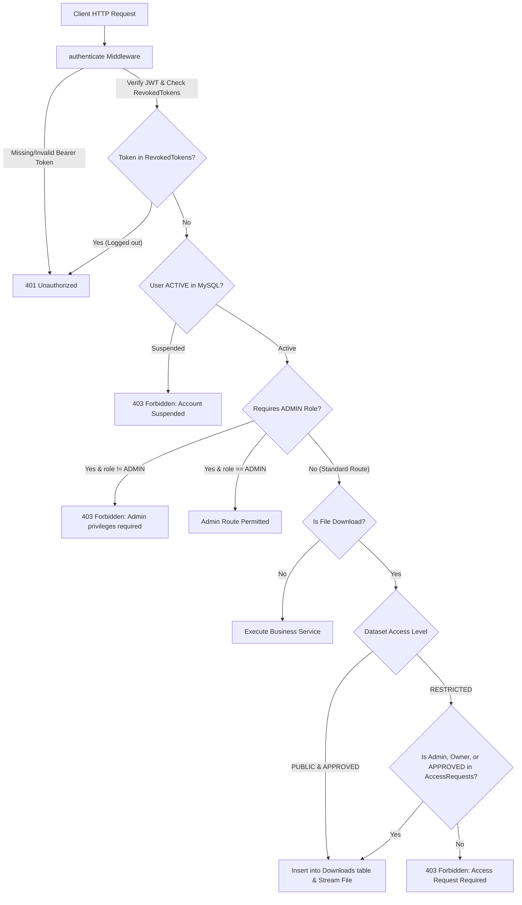
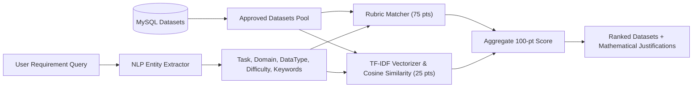

# AI Dataset Repository with Secure Access and Intelligent Dataset Recommendation

> **College DBMS Project-Based Learning (PBL)**  
> **Course:** Database Management Systems (CS / IT)  
> **Target Database Engine:** MySQL 8 Community Server  
> **Stack:** MySQL 8, Node.js, Express.js, React 18, Vite 6, Tailwind CSS 3

---

## Table of Contents
1. [Project Overview & Objectives](#1-project-overview--objectives)
2. [Technology Stack](#2-technology-stack)
3. [Relational Database Design & Normalization](#3-relational-database-design--normalization)
   - [Normalization to 3NF](#normalization-to-3nf)
   - [Entity-Relationship (ER) Diagram](#entity-relationship-er-diagram)
   - [Data Dictionary & Table Schemas](#data-dictionary--table-schemas)
   - [Real UCI Benchmark Datasets](#real-uci-benchmark-datasets)
4. [Advanced DBMS Concepts & Implementation](#4-advanced-dbms-concepts--implementation)
   - [ACID Transactions](#acid-transactions)
   - [Referential Integrity & Cascading Constraints](#referential-integrity--cascading-constraints)
   - [Functional Indexes for Complex Business Rules](#functional-indexes-for-complex-business-rules)
   - [Database Views](#database-views)
   - [Academic SQL Queries Showcase](#academic-sql-queries-showcase)
5. [Security Architecture & Access Control](#5-security-architecture--access-control)
   - [Password Hashing with bcrypt](#password-hashing-with-bcrypt)
   - [JWT Authentication & Token Revocation Strategy](#jwt-authentication--token-revocation-strategy)
   - [Role-Based Access Control (USER vs ADMIN)](#role-based-access-control-user-vs-admin)
   - [Download Security Gate & Audit Trails](#download-security-gate--audit-trails)
6. [Intelligent Content-Based Dataset Recommender](#6-intelligent-content-based-dataset-recommender)
   - [Mathematical Formulation](#mathematical-formulation)
   - [100-Point Scoring Rubric](#100-point-scoring-rubric)
   - [TF-IDF & Cosine Similarity Implementation](#tf-idf--cosine-similarity-implementation)
   - [Transparent Quality Handling](#transparent-quality-handling)
7. [Admin Analytics Dashboard](#7-admin-analytics-dashboard)
8. [System Architecture](#8-system-architecture)
9. [Installation & Setup Guide](#9-installation--setup-guide)
   - [Database Setup](#database-setup)
   - [Backend Configuration & Execution](#backend-configuration--execution)
   - [Frontend Configuration & Execution](#frontend-configuration--execution)
   - [Seed User Accounts](#seed-user-accounts)
10. [REST API Documentation](#10-rest-api-documentation)
11. [Automated Verification & Test Suites](#11-automated-verification--test-suites)

---

## 1. Project Overview & Objectives

In modern machine learning and artificial intelligence workflows, data discovery, quality assurance, access governance, and compliance are paramount. The **AI Dataset Repository** is a secure, full-stack, enterprise-grade web application engineered to discover, upload, govern, rate, review, and request access to artificial intelligence datasets.

### Core Objectives:
* **Academic Rigor in Relational Design:** Structure a real-world schema normalized to Third Normal Form (3NF) with strict constraints, indexes, and referential integrity in MySQL 8.
* **Dual-Tier Role-Based Governance:** Provide fine-grained access control separating regular users (students, ML engineers) and system administrators.
* **Granular Data Access Control:** Enforce dual visibility tiers (`PUBLIC` vs `RESTRICTED`) where restricted research datasets require formal access justification, administrative review, and strict audit logging.
* **ACID Transactions:** Guarantee atomicity and isolation across multi-table operations (e.g., dataset ingestion with tag linking, access approval with audit history, atomic rating upserts).
* **Mathematical Dataset Recommendation:** Provide an explainable, content-based recommendation engine utilizing structured attribute scoring, rule-based NLP extraction, and pure mathematical TF-IDF vectorization with cosine similarity.
* **Repository Analytics:** Deliver real-time administrative visibility into dataset velocity, downloads, domain distributions, and access metrics via SQL aggregate queries and views.

---

## 2. Technology Stack

| Layer | Technologies | Role in System |
| :--- | :--- | :--- |
| **Database** | **MySQL 8.0 Community Server** | Relational data persistence, 3NF normalization, transactional integrity, functional indexes, views, and audit logs. |
| **Database Driver** | **mysql2/promise** | High-performance asynchronous connection pooling, parameterized queries preventing SQL injection. |
| **Backend Runtime** | **Node.js (v20+)** | Asynchronous JavaScript runtime environment. |
| **Web Framework** | **Express.js 4** | Modular RESTful API architecture, centralized error handling, routing, and middleware pipelines. |
| **Authentication & Security** | **bcryptjs (10 rounds)**, **jsonwebtoken (JWT)** | Cryptographic salt-hashed password storage, signed stateless authentication, and state-backed token revocation. |
| **File Handling** | **Multer 1.4** | Server-side disk file storage for CSV and ZIP datasets (`backend/uploads/datasets/`) with MIME and size filters. |
| **Frontend Framework** | **React 18** | Declarative, component-based user interface. |
| **Build Tool** | **Vite 6** | Ultra-fast build pipeline and Hot Module Replacement (HMR). |
| **Styling** | **Tailwind CSS 3** | Utility-first responsive SaaS layout and aesthetic design. |
| **Routing & Icons** | **React Router 6**, **Lucide React** | Client-side routing, navigation guards, and iconography. |
| **HTTP Client** | **Axios 1.7** | Asynchronous HTTP requests with JWT request/response interceptors. |

---

## 3. Relational Database Design & Normalization

### Normalization to 3NF

The relational schema was designed following relational calculus and database normalization principles:

#### 1. First Normal Form (1NF) Compliance:
* **Atomic Attributes:** Every column contains indivisible, atomic values. Multivalued attributes such as dataset keywords/tags are not stored as comma-separated strings inside `Datasets`; they are isolated into dedicated entities (`Tags` and `Dataset_Tags`).
* **Uniquely Identifiable Tuples:** Every relation possesses a primary key (`user_id`, `category_id`, `dataset_id`, `tag_id`, `request_id`, `download_id`, `rating_id`, `review_id`).
* **Consistent Data Types:** Columns conform to fixed domain constraints (`VARCHAR`, `INT`, `BIGINT`, `DECIMAL`, `ENUM`, `TIMESTAMP`).

#### 2. Second Normal Form (2NF) Compliance:
* Must satisfy 1NF.
* **No Partial Functional Dependencies:** All non-key attributes are fully functionally dependent on the relation's entire candidate key.
* In composite-key associative tables (e.g., `Dataset_Tags (dataset_id, tag_id)`), only the junction relationship exists without partial attributes.
* In `Ratings` and `Reviews`, composite unique pairs `(user_id, dataset_id)` are enforced while surrogate keys serve as PKs.

#### 3. Third Normal Form (3NF) Compliance:
* Must satisfy 2NF.
* **No Transitive Functional Dependencies ($X \to Y \to Z$):**
  * `Datasets` references `category_id` rather than redundantly copying `category_name` or category descriptions.
  * `Downloads`, `AccessRequests`, `Ratings`, and `Reviews` reference foreign keys (`user_id`, `dataset_id`) rather than repeating user emails or dataset titles.
  * If a user updates their name or an administrator edits a category description, the modification occurs in exactly one tuple, eliminating update anomalies.

---

### Entity-Relationship (ER) Diagram



---

### Data Dictionary & Table Schemas

#### 1. `Users`
Holds credentials, profile metadata, roles, and suspension states.
* `user_id` (INT, PK, AUTO_INCREMENT)
* `full_name` (VARCHAR(100), NOT NULL)
* `email` (VARCHAR(191), UNIQUE, NOT NULL)
* `password_hash` (VARCHAR(255), NOT NULL) — 60-character bcrypt hash
* `role` (ENUM('USER', 'ADMIN'), DEFAULT 'USER', NOT NULL)
* `status` (ENUM('ACTIVE', 'SUSPENDED'), DEFAULT 'ACTIVE', NOT NULL)
* `created_at` / `updated_at` (TIMESTAMP)

#### 2. `RevokedTokens`
Stores revoked JWT hashes upon user logout, providing instant token invalidation while preserving stateless JWT performance.
* `token_id` (BIGINT, PK, AUTO_INCREMENT)
* `token_hash` (CHAR(64), UNIQUE, NOT NULL) — SHA-256 hash of JWT
* `user_id` (INT, FK -> `Users(user_id)` ON DELETE CASCADE)
* `expires_at` (TIMESTAMP, NOT NULL)
* `created_at` (TIMESTAMP)

#### 3. `Categories`
High-level domains grouping datasets (e.g., Computer Vision, NLP, Healthcare).
* `category_id` (INT, PK, AUTO_INCREMENT)
* `name` (VARCHAR(100), UNIQUE, NOT NULL)
* `description` (TEXT)
* `created_at` / `updated_at` (TIMESTAMP)

#### 4. `Datasets`
Core repository entity containing machine learning metadata and storage pointers.
* `dataset_id` (INT, PK, AUTO_INCREMENT)
* `title` (VARCHAR(200), NOT NULL)
* `description` (TEXT, NOT NULL)
* `category_id` (INT, FK -> `Categories(category_id)` ON DELETE RESTRICT)
* `uploader_id` (INT, FK -> `Users(user_id)` ON DELETE RESTRICT)
* `domain` (VARCHAR(100), NOT NULL)
* `task_type` (ENUM('Classification', 'Regression', 'Clustering', 'NLP', 'Computer Vision', 'Other'), NOT NULL)
* `data_type` (ENUM('Tabular', 'Text', 'Image', 'Audio', 'Time-Series', 'Multimodal'), NOT NULL)
* `difficulty_level` (ENUM('BEGINNER', 'INTERMEDIATE', 'ADVANCED'), NOT NULL)
* `file_name` (VARCHAR(255), NOT NULL)
* `file_path` (VARCHAR(500), NOT NULL) — Local server path (isolated from API consumers)
* `file_size_bytes` (BIGINT, NOT NULL, CHECK > 0)
* `file_format` (VARCHAR(20), NOT NULL) — `.csv`, `.zip`
* `num_rows` / `num_columns` (INT, NULLABLE)
* `quality_score` (DECIMAL(4,2), NULLABLE, CHECK 0.00 to 100.00)
* `access_level` (ENUM('PUBLIC', 'RESTRICTED'), DEFAULT 'PUBLIC')
* `approval_status` (ENUM('PENDING', 'APPROVED', 'REJECTED'), DEFAULT 'PENDING')
* `rejection_reason` (TEXT, NULLABLE)
* `license` (VARCHAR(100), DEFAULT 'CC BY 4.0')
* `source_url` (VARCHAR(500), NULLABLE)
* `created_at` / `updated_at` (TIMESTAMP)

#### 5. `Tags` & `Dataset_Tags`
Provides many-to-many relationship mapping keywords to datasets.
* `Tags`: `tag_id` (INT, PK), `tag_name` (VARCHAR(50), UNIQUE, NOT NULL)
* `Dataset_Tags`: Composite PK `(dataset_id, tag_id)` with cascading foreign keys.

#### 6. `AccessRequests`
Tracks formal permission requests submitted by users for `RESTRICTED` datasets.
* `request_id` (INT, PK, AUTO_INCREMENT)
* `user_id` (INT, FK -> `Users(user_id)` ON DELETE CASCADE)
* `dataset_id` (INT, FK -> `Datasets(dataset_id)` ON DELETE CASCADE)
* `purpose_justification` (TEXT, NOT NULL)
* `status` (ENUM('PENDING', 'APPROVED', 'REJECTED'), DEFAULT 'PENDING')
* `reviewed_by` (INT, NULLABLE, FK -> `Users(user_id)`)
* `rejection_reason` (TEXT, NULLABLE)
* `created_at` / `reviewed_at` (TIMESTAMP)
* **Functional Expression Index:**
  ```sql
  CREATE UNIQUE INDEX uk_pending_access_request 
  ON AccessRequests ((CASE WHEN status = 'PENDING' THEN CONCAT(user_id, '_', dataset_id) ELSE NULL END));
  ```
  *Ensures a user may only possess at most ONE active `PENDING` request per dataset, while permitting multiple historical `REJECTED` or `APPROVED` records.*

#### 7. `Downloads`
Audit table recording every dataset download.
* `download_id` (BIGINT, PK, AUTO_INCREMENT)
* `dataset_id` (INT, FK -> `Datasets(dataset_id)` ON DELETE CASCADE)
* `user_id` (INT, FK -> `Users(user_id)` ON DELETE CASCADE)
* `ip_address` (VARCHAR(45))
* `user_agent` (VARCHAR(255))
* `downloaded_at` (TIMESTAMP DEFAULT CURRENT_TIMESTAMP)

#### 8. `Ratings` & `Reviews`
Feedback tables capturing user sentiment.
* `Ratings`: `rating_id` (INT, PK), `dataset_id` (INT, FK), `user_id` (INT, FK), `rating` (TINYINT, CHECK 1 to 5). Unique constraint: `UNIQUE (user_id, dataset_id)`.
* `Reviews`: `review_id` (INT, PK), `dataset_id` (INT, FK), `user_id` (INT, FK), `review_text` (TEXT, NOT NULL), `created_at` / `updated_at` (TIMESTAMP).

---

### Real UCI Benchmark Datasets

The repository is seeded with 5 authentic, verified machine learning datasets from the **UC Irvine Machine Learning Repository**:

| Dataset Name | UCI ID | Domain | Task Type | Data Type | Difficulty | Visibility | Official License | Source Citation |
| :--- | :---: | :--- | :--- | :--- | :--- | :--- | :--- | :--- |
| **Iris** | #53 | Life Sciences / Botany | Classification | Tabular | BEGINNER | `PUBLIC` | CC BY 4.0 | Fisher, R.A. (1936). [UCI #53](https://archive.ics.uci.edu/dataset/53/iris) |
| **Heart Disease** | #45 | Healthcare / Cardiology | Classification | Tabular | INTERMEDIATE | `RESTRICTED` | CC BY 4.0 | Janosi, Steinbrunn, Pfisterer, Detrano (1988). [UCI #45](https://archive.ics.uci.edu/dataset/45/heart+disease) |
| **Wine Quality** | #186 | Agriculture / Enology | Classification | Tabular | BEGINNER | `PUBLIC` | CC BY 4.0 | Cortez, Cerdeira, Almeida, Matos, Reis (2009). [UCI #186](https://archive.ics.uci.edu/dataset/186/wine+quality) |
| **Breast Cancer Wisconsin** | #17 | Healthcare / Oncology | Classification | Tabular | INTERMEDIATE | `RESTRICTED` | CC BY 4.0 | Wolberg, Street, Mangasarian (1995). [UCI #17](https://archive.ics.uci.edu/dataset/17/breast+cancer+wisconsin+diagnostic) |
| **Student Performance** | #320 | Social Sciences / Education | Regression | Tabular | BEGINNER | `PUBLIC` | CC BY 4.0 | Cortez, Silva (2008). [UCI #320](https://archive.ics.uci.edu/dataset/320/student+performance) |

---

## 4. Advanced DBMS Concepts & Implementation

### ACID Transactions

Transactions are employed across all composite database operations using `connection.beginTransaction()`, `connection.commit()`, and `connection.rollback()`.

1. **Dataset Ingestion Transaction:**
   ```sql
   START TRANSACTION;
   INSERT INTO Datasets (title, description, category_id, uploader_id, domain, ...) VALUES (...);
   -- Retrieve generated dataset_id
   INSERT INTO Tags (tag_name) VALUES (?) ON DUPLICATE KEY UPDATE tag_id=LAST_INSERT_ID(tag_id);
   INSERT INTO Dataset_Tags (dataset_id, tag_id) VALUES (?, ?);
   COMMIT;
   ```
   *Guarantees that if tag association or file persistence fails, no orphaned dataset record is left in the database.*

2. **Access Request Review Transaction:**
   ```sql
   START TRANSACTION;
   UPDATE AccessRequests 
   SET status = 'APPROVED', reviewed_by = ?, reviewed_at = NOW() 
   WHERE request_id = ?;
   -- Audit trail update or access event notification
   COMMIT;
   ```

3. **Atomic Rating Upsert:**
   ```sql
   INSERT INTO Ratings (dataset_id, user_id, rating) 
   VALUES (?, ?, ?) 
   ON DUPLICATE KEY UPDATE rating = VALUES(rating), updated_at = NOW();
   ```
   *Guarantees idempotency and prevents concurrent duplicate rating rows for the same user-dataset pair.*

---

### Referential Integrity & Cascading Constraints

* **`ON DELETE CASCADE`** is implemented on secondary dependent tables (`Downloads`, `Ratings`, `Reviews`, `AccessRequests`, `RevokedTokens`, `Dataset_Tags`). If a dataset or user is deleted, all dependent audit logs, tags, and ratings are cleaned up automatically.
* **`ON DELETE RESTRICT`** is implemented between `Categories` and `Datasets`, and between `Users` and uploaded `Datasets`. A category cannot be dropped while active datasets reference it, ensuring no metadata references become invalid.

---

### Functional Indexes for Complex Business Rules

In standard MySQL 8, defining unique constraints conditionally across active rows is not directly supported by simple table constraints. Our application uses a **MySQL 8 functional index**:

```sql
CREATE UNIQUE INDEX uk_pending_access_request 
ON AccessRequests ((
    CASE 
        WHEN status = 'PENDING' THEN CONCAT(user_id, '_', dataset_id) 
        ELSE NULL 
    END
));
```

**Why this works:**
* When `status = 'PENDING'`, the expression evaluates to `'<user_id>_<dataset_id>'`. Any subsequent attempt by the same user to submit a pending request for the same dataset produces a duplicate key error (`ER_DUP_ENTRY`).
* When `status IN ('APPROVED', 'REJECTED')`, the expression evaluates to `NULL`. Since B-tree unique indexes permit multiple `NULL` values, users retain their historical request records and can submit a new request if previously rejected.

---

### Database Views

Two database views are maintained to simplify reporting and decouple application queries from underlying joins:

#### 1. `vw_dataset_summary`
Aggregates dataset details with uploader name, category, calculated average rating, total ratings count, and total downloads:

```sql
CREATE OR REPLACE VIEW vw_dataset_summary AS
SELECT 
    d.dataset_id,
    d.title,
    d.description,
    d.domain,
    d.task_type,
    d.data_type,
    d.difficulty_level,
    d.access_level,
    d.approval_status,
    d.license,
    d.source_url,
    d.file_name,
    d.file_size_bytes,
    d.file_format,
    d.num_rows,
    d.num_columns,
    d.quality_score,
    d.created_at,
    c.category_id,
    c.name AS category_name,
    u.user_id AS uploader_id,
    u.full_name AS uploader_name,
    COALESCE(ROUND(AVG(r.rating), 2), 0.00) AS avg_rating,
    COUNT(DISTINCT r.rating_id) AS total_ratings,
    COUNT(DISTINCT dl.download_id) AS total_downloads
FROM Datasets d
JOIN Categories c ON d.category_id = c.category_id
JOIN Users u ON d.uploader_id = u.user_id
LEFT JOIN Ratings r ON d.dataset_id = r.dataset_id
LEFT JOIN Downloads dl ON d.dataset_id = dl.dataset_id
GROUP BY d.dataset_id, c.category_id, u.user_id;
```

#### 2. `vw_admin_repository_analytics`
Provides instantaneous KPI metrics for administrators:

```sql
CREATE OR REPLACE VIEW vw_admin_repository_analytics AS
SELECT 
    (SELECT COUNT(*) FROM Users WHERE role = 'USER') AS total_regular_users,
    (SELECT COUNT(*) FROM Datasets WHERE approval_status = 'APPROVED') AS total_approved_datasets,
    (SELECT COUNT(*) FROM Datasets WHERE approval_status = 'PENDING') AS pending_dataset_approvals,
    (SELECT COUNT(*) FROM AccessRequests WHERE status = 'PENDING') AS pending_access_requests,
    (SELECT COUNT(*) FROM Downloads) AS total_downloads_serviced,
    (SELECT ROUND(AVG(rating), 2) FROM Ratings) AS platform_average_rating;
```

---

### Academic SQL Queries Showcase

Located in [`database/queries.sql`](file:///c:/Users/gaurm/Downloads/claude%20antigravity/ai-dataset-repository/database/queries.sql):

1. **Complex Multi-Table JOIN with GROUP BY and HAVING:**
   Finds high-performing datasets having more than 5 downloads and an average rating $\ge 4.0$:
   ```sql
   SELECT 
       d.dataset_id,
       d.title,
       c.name AS category,
       COUNT(DISTINCT dl.download_id) AS download_count,
       ROUND(AVG(r.rating), 2) AS average_rating
   FROM Datasets d
   INNER JOIN Categories c ON d.category_id = c.category_id
   LEFT JOIN Downloads dl ON d.dataset_id = dl.dataset_id
   LEFT JOIN Ratings r ON d.dataset_id = r.dataset_id
   WHERE d.approval_status = 'APPROVED'
   GROUP BY d.dataset_id, d.title, c.name
   HAVING download_count >= 1 AND average_rating >= 4.0
   ORDER BY download_count DESC, average_rating DESC;
   ```

2. **Correlated Subquery:**
   Identifies users whose total dataset downloads exceed the global average user download count:
   ```sql
   SELECT u.user_id, u.full_name, u.email, COUNT(dl.download_id) AS user_downloads
   FROM Users u
   JOIN Downloads dl ON u.user_id = dl.user_id
   GROUP BY u.user_id, u.full_name, u.email
   HAVING user_downloads > (
       SELECT COUNT(download_id) / COUNT(DISTINCT user_id) 
       FROM Downloads
   );
   ```

3. **Subquery with `NOT EXISTS`:**
   Discovers approved datasets that have zero access requests and zero downloads:
   ```sql
   SELECT d.dataset_id, d.title, d.access_level
   FROM Datasets d
   WHERE d.approval_status = 'APPROVED'
     AND NOT EXISTS (
         SELECT 1 FROM Downloads dl WHERE dl.dataset_id = d.dataset_id
     )
     AND NOT EXISTS (
         SELECT 1 FROM AccessRequests ar WHERE ar.dataset_id = d.dataset_id
     );
   ```

---

## 5. Security Architecture & Access Control



### Password Hashing with bcrypt
* Plaintext passwords are never stored or logged.
* Passwords undergo one-way cryptographic hashing using **bcrypt** with a work factor of 10 rounds (`bcrypt.hash(password, 10)`).
* Password verification uses `bcrypt.compare(candidate, stored_hash)` resistant to timing attacks.

### JWT Authentication & Token Revocation Strategy
* Standard JWT tokens are issued with user identifiers (`userId`, `email`, `role`, unique `jti`) and expired after 7 days.
* **Instant Logout & Suspension Invalidation:** To overcome the stateless revocation weakness of standard JWTs, the system integrates a `RevokedTokens` MySQL table. Upon `POST /api/auth/logout`, the token's SHA-256 hash is inserted. Every protected request checks this table; revoked tokens are instantly denied (`401 Unauthorized`).
* Every authenticated call also queries `Users.status`. If an administrator marks a user `SUSPENDED`, all subsequent calls using their existing JWT fail immediately (`403 Forbidden`).

### Role-Based Access Control (USER vs ADMIN)
* **Never Trust Frontend Checks:** All authorization logic is enforced on Express route middleware (`requireAdmin`, `authenticate`).
* Self-promotion prevention: The registration API hardcodes `role = 'USER'`. Administrator accounts can only be designated directly in the database or by an active administrator.

### Download Security Gate & Audit Trails
* **No Unrestricted Public File URLs:** Dataset files reside outside Express static directories in `backend/uploads/datasets/`.
* The server file system paths (`file_path`) are never returned in public APIs.
* Downloads are requested via `GET /api/datasets/:id/download`.
* **Verification Pipeline:**
  1. Authenticate user.
  2. Verify dataset is `APPROVED`.
  3. If `access_level = 'RESTRICTED'`, query `AccessRequests` for an active `APPROVED` tuple for `(user_id, dataset_id)`. If absent, return `403 Forbidden`.
  4. Stream file via `res.download()`.
  5. Asynchronously insert an audit record into `Downloads (dataset_id, user_id, ip_address, user_agent, downloaded_at)`.

---

## 6. Intelligent Content-Based Dataset Recommender

The recommendation engine delivers explainable, transparent dataset rankings using a 100-point rubric combined with NLP entity extraction and TF-IDF cosine similarity.



### 100-Point Scoring Rubric

$$\text{Total Score} = S_{\text{Task}} + S_{\text{Domain}} + S_{\text{DataType}} + S_{\text{Difficulty}} + S_{\text{Quality}} + S_{\text{Rating}}$$

| Component | Maximum Points | Evaluation Criteria |
| :--- | :---: | :--- |
| **Task Match ($S_{\text{Task}}$)** | **30 pts** | Exact case-insensitive match on `task_type` (e.g., Classification, Regression). |
| **Domain Match ($S_{\text{Domain}}$)** | **25 pts** | Exact or substring match on `domain` (e.g., Healthcare, Agriculture, Life Sciences). |
| **Data Type Match ($S_{\text{DataType}}$)** | **20 pts** | Exact match on `data_type` (e.g., Tabular, Image, Text). |
| **Difficulty Match ($S_{\text{Difficulty}}$)** | **10 pts** | Exact match on `difficulty_level` (BEGINNER, INTERMEDIATE, ADVANCED). |
| **Dataset Quality ($S_{\text{Quality}}$)** | **10 pts** | Scaled verified quality score: $\min(10, \frac{\text{quality\_score}}{10})$. If `quality_score IS NULL`, awards 0 pts. |
| **User Rating ($S_{\text{Rating}}$)** | **5 pts** | Scaled community star rating: $\min(5, \text{avg\_rating})$. |
| **Total Possible** | **100 pts** | **Match Percentage $= \min(100, \text{Total Score})\%$** |

### TF-IDF & Cosine Similarity Implementation

When users enter free-form descriptions, the system performs content-based Information Retrieval:
1. **Term Frequency (TF):**
   $$\text{TF}(t, d) = \frac{f_{t,d}}{\sum_{t' \in d} f_{t',d}}$$
2. **Inverse Document Frequency (IDF):**
   $$\text{IDF}(t, D) = \ln\left(1 + \frac{|D|}{1 + |\{d \in D : t \in d\}|}\right)$$
3. **Cosine Similarity:**
   $$\text{CosineSimilarity}(\vec{q}, \vec{d}) = \frac{\vec{q} \cdot \vec{d}}{\|\vec{q}\|_2 \|\vec{d}\|_2}$$

*The similarity coefficient boosts domain, title, and keyword matches when users express nuanced requirements.*

### Transparent Quality Handling
* The system never invents fake quality metrics. If a dataset has no verified benchmark score (`quality_score IS NULL`), the recommender explicitly assigns 0/10 points and outputs a transparent explanation: `"Quality score not benchmarked (0/10)"`.

---

## 7. Admin Analytics Dashboard

The administrative analytics portal is backed by SQL aggregation queries and database views:
* **Metric Cards:** Live user count, approved datasets count, pending access requests count, and lifetime downloads.
* **Category Distribution:** Distribution of repository volume across high-level categories.
* **Domain Distribution:** Relative breakdown of datasets across Healthcare, Life Sciences, Agriculture, and Social Sciences.
* **Dataset Downloads Leaderboard:** Real-time query of top-performing datasets using `COUNT(dl.download_id)`.
* **Live Audit Log:** Real-time feed of recent downloads with user ID, dataset name, IP address, and timestamp.

---

## 8. System Architecture

```
ai-dataset-repository/
├── database/
│   ├── schema.sql           # Complete MySQL 8 DDL with tables, indexes, views, checks
│   ├── seed.sql             # Real UCI datasets metadata, admin & student seed data
│   └── queries.sql          # Academic SQL queries (JOINs, HAVING, Subqueries, Views)
├── backend/
│   ├── .env.example         # Template for environment configuration
│   ├── package.json         # Express, mysql2, bcryptjs, jsonwebtoken, multer
│   ├── uploads/datasets/    # Local disk directory for uploaded dataset files
│   ├── src/
│   │   ├── server.js        # Express application bootstrap & route mounting
│   │   ├── config/db.js     # mysql2 connection pool with keep-alive
│   │   ├── middleware/      # auth, role, upload, and error middleware
│   │   ├── controllers/     # auth, category, dataset, access, review, admin, recommender
│   │   ├── services/        # Business logic & parameterized SQL queries
│   │   └── utils/           # tfidf.js, entityExtractor.js, response.js, validators.js
│   └── test/
│       ├── api-test.js              # Integration test suite for core REST endpoints
│       ├── auth-rbac-test.js        # Authentication & RBAC security test suite
│       ├── dataset-storage-test.js  # File upload & download gate test suite
│       └── recommendation-test.js   # AI recommender & mathematical rubric test suite
└── frontend/
    ├── package.json         # React 18, Vite 6, Tailwind CSS 3, Axios, Lucide
    ├── vite.config.js       # Vite build configuration with API reverse proxy
    ├── tailwind.config.js   # Tailwind custom styling theme
    └── src/
        ├── App.jsx          # Route hierarchy with ProtectedRoute guards
        ├── main.jsx         # React application entry point
        ├── context/         # AuthContext with token persistence & active role state
        ├── services/api.js  # Centralized Axios client with JWT interceptors
        ├── components/      # Navbar, Sidebar, Footer, DatasetCard, Badge, Modal, etc.
        └── pages/           # Landing, Login, Register, Repositories, Upload, Admin, AI
```

---

## 9. Installation & Setup Guide

### Prerequisites
* **MySQL 8.0 Community Server** running locally on port `3306`.
* **Node.js (v20 or v22 LTS recommended)** and `npm`.

---

### Database Setup

1. Start your local MySQL 8 server.
2. Open a terminal or MySQL Workbench and run:
   ```bash
   mysql -u root -p < database/schema.sql
   mysql -u root -p < database/seed.sql
   ```
   *(Or copy-paste the contents into MySQL Workbench / phpMyAdmin).*
3. Verify table creation:
   ```sql
   USE ai_dataset_repository;
   SHOW TABLES;
   SELECT dataset_id, title, access_level, approval_status FROM Datasets;
   ```

---

### Backend Configuration & Execution

1. Navigate to the backend directory:
   ```bash
   cd backend
   ```
2. Create or verify your `.env` file:
   ```ini
   PORT=5000
   NODE_ENV=development
   DB_HOST=127.0.0.1
   DB_PORT=3306
   DB_USER=root
   DB_PASSWORD=YourMySQLPassword
   DB_NAME=ai_dataset_repository
   JWT_SECRET=super-secret-jwt-key-for-academic-pbl-project-2026
   JWT_EXPIRES_IN=7d
   MAX_FILE_SIZE_MB=50
   ```
3. Install dependencies:
   ```bash
   npm install
   ```
4. Start the backend development server:
   ```bash
   npm run dev
   # Server runs at http://localhost:5000
   ```

---

### Frontend Configuration & Execution

1. Navigate to the frontend directory:
   ```bash
   cd ../frontend
   ```
2. Install frontend dependencies:
   ```bash
   npm install
   ```
3. Start the Vite development server:
   ```bash
   npm run dev
   # Application opens at http://localhost:3000
   ```
4. To test a production build:
   ```bash
   npm run build
   ```

---

### Seed User Accounts

| Role | Email Address | Password | Permissions |
| :--- | :--- | :--- | :--- |
| **System Administrator** | `admin@aixplore.edu` | `Admin@12345` | Full administrative control, dataset approvals, user suspension, access request reviews, analytics. |
| **Student / Researcher** | `alice@aixplore.edu` | `User@12345` | Public dataset browsing & downloads, uploading new datasets, requesting restricted dataset access, rating and reviewing. |

---

## 10. REST API Documentation

### Authentication & User Management (`/api/auth`)
* `POST /api/auth/register` — Register a student account (`name`, `email`, `password`).
* `POST /api/auth/login` — Login with credentials, returns signed JWT.
* `POST /api/auth/logout` — Revokes active JWT and persists hash to `RevokedTokens`.
* `GET /api/auth/me` — *(Auth)* Retrieve active user identity and role.
* `GET /api/auth/users` — *(Admin)* List all platform users with statistics.
* `PATCH /api/auth/users/:id/status` — *(Admin)* Toggle user status (`ACTIVE` vs `SUSPENDED`).

### Datasets (`/api/datasets`)
* `GET /api/datasets` — Discover approved datasets with search, filters (`domain`, `task_type`, `data_type`, `difficulty_level`, `access_level`), sorting, and pagination.
* `GET /api/datasets/:id` — Full dataset metadata, uploader, tags, average rating, reviews, and current user's access status.
* `POST /api/datasets` — *(Auth)* Upload a dataset (`multipart/form-data` with `.csv` or `.zip` file).
* `PUT /api/datasets/:id` — *(Auth: Owner or Admin)* Update dataset metadata.
* `DELETE /api/datasets/:id` — *(Auth: Owner or Admin)* Delete dataset and associated file.
* `PATCH /api/datasets/:id/approval` — *(Admin)* Approve or reject a dataset (`status`, `rejection_reason`).
* `GET /api/datasets/:id/download` — *(Auth)* Secure download stream. Enforces access permissions and records download audit log.
* `GET /api/datasets/my/uploads` — *(Auth)* View personal uploads and approval statuses.
* `GET /api/datasets/my/downloads` — *(Auth)* View personal download history.

### Access Requests (`/api/access-requests`)
* `POST /api/access-requests` — *(Auth)* Submit access request for a `RESTRICTED` dataset with research justification.
* `GET /api/access-requests/my` — *(Auth)* List user's access requests and outcomes.
* `GET /api/access-requests` — *(Admin)* List all pending, approved, and rejected access requests.
* `PATCH /api/access-requests/:id/review` — *(Admin)* Approve or reject access request.

### Ratings & Reviews (`/api`)
* `POST /api/ratings` — *(Auth)* Rate dataset (1 to 5 stars) via atomic upsert.
* `POST /api/reviews` — *(Auth)* Post substantive text feedback for a dataset.
* `GET /api/reviews/:id` — Get all reviews and timestamps for a dataset.
* `DELETE /api/reviews/:id` — *(Auth: Author or Admin)* Delete review.

### AI Recommendations (`/api/recommendations`)
* `POST /api/recommendations` — Submit project requirements (free-text prompt or structured attributes). Returns ranked datasets with rubric score breakdowns and transparent explanations.

### Admin Analytics (`/api/admin/analytics`)
* `GET /api/admin/analytics` — *(Admin)* Get repository KPIs, category volume distribution, domain breakdown, access split, top downloaded datasets, and recent audit records.

---

## 11. Automated Verification & Test Suites

The backend includes four comprehensive automated integration test suites:

```bash
cd backend
npm run test:api         # Tests 23 core API workflows (Health, Auth, Datasets, Access, Downloads, Ratings, Analytics)
npm run test:auth        # Tests 24 Auth & RBAC scenarios (Registration, Login, Suspended account, Token revocation)
npm run test:storage     # Tests 22 Storage & Gate scenarios (Uploads, Approval, Restricted gate, Downloads audit)
npm run test:recommend   # Tests 18 AI Recommendation scenarios (NLP extraction, TF-IDF, Cosine similarity, 5 UCI benchmarks)
```

### Cumulative Test Results:

| Test Suite | File | Tests Run | Passed | Failed |
| :--- | :--- | :---: | :---: | :---: |
| Core API Integration | [`test/api-test.js`](file:///c:/Users/gaurm/Downloads/claude%20antigravity/ai-dataset-repository/backend/test/api-test.js) | 23 | 23 | 0 |
| Authentication & RBAC | [`test/auth-rbac-test.js`](file:///c:/Users/gaurm/Downloads/claude%20antigravity/ai-dataset-repository/backend/test/auth-rbac-test.js) | 24 | 24 | 0 |
| Dataset Storage & Download Gate | [`test/dataset-storage-test.js`](file:///c:/Users/gaurm/Downloads/claude%20antigravity/ai-dataset-repository/backend/test/dataset-storage-test.js) | 22 | 22 | 0 |
| AI Recommendation & Scoring | [`test/recommendation-test.js`](file:///c:/Users/gaurm/Downloads/claude%20antigravity/ai-dataset-repository/backend/test/recommendation-test.js) | 18 | 18 | 0 |
| **Total** | | **87** | **87** | **0** |

---

## Academic Project Declaration

This project was built from scratch as an academic **Database Management Systems (DBMS) Project-Based Learning (PBL)** solution. All database designs follow relational algebra, 3NF normalization, ACID transaction guarantees, and secure role-based access control. The recommendation component is a deterministic, explainable mathematical model utilizing structured weighted scoring, NLP parsing, and TF-IDF cosine similarity. No synthetic deep learning claims are made.
